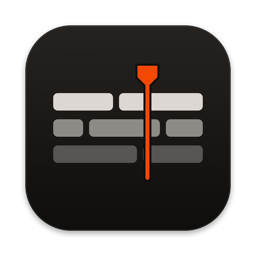
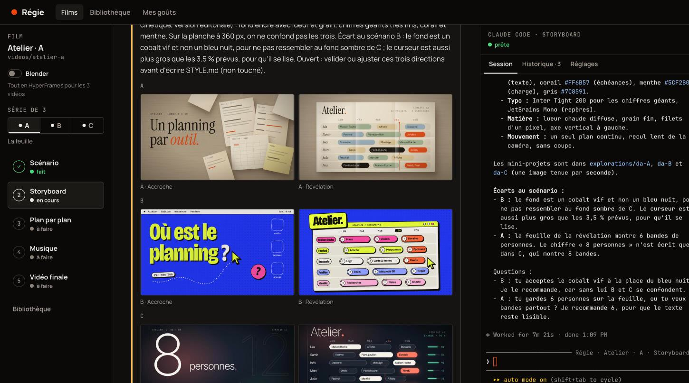
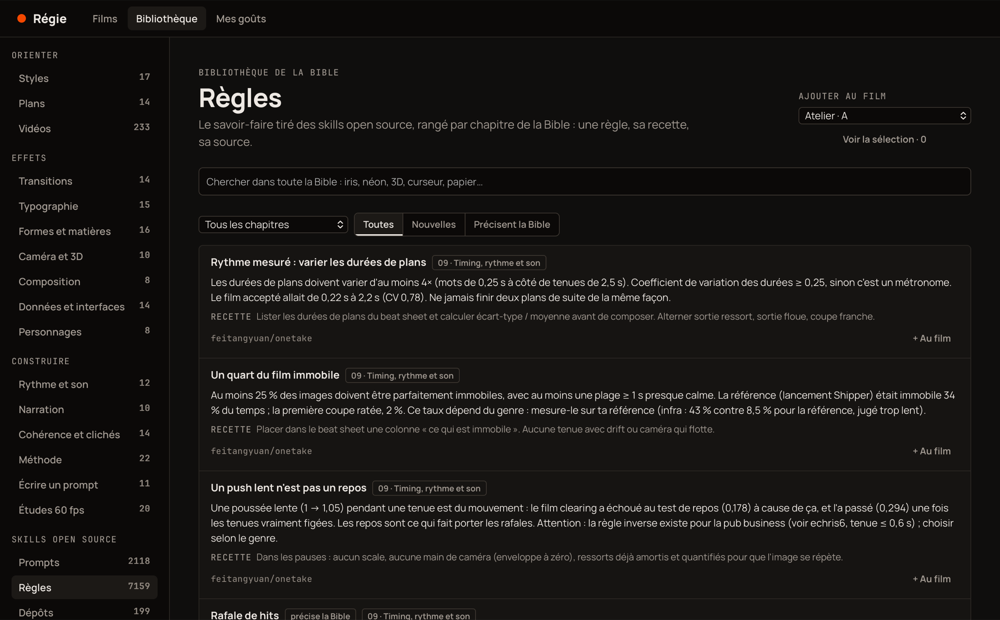
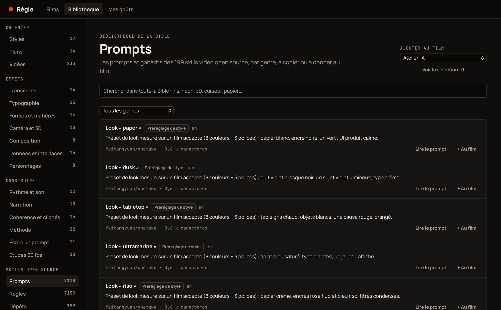
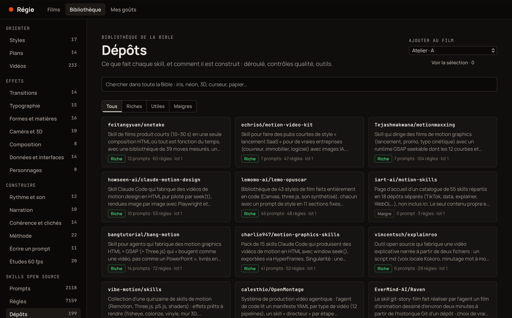
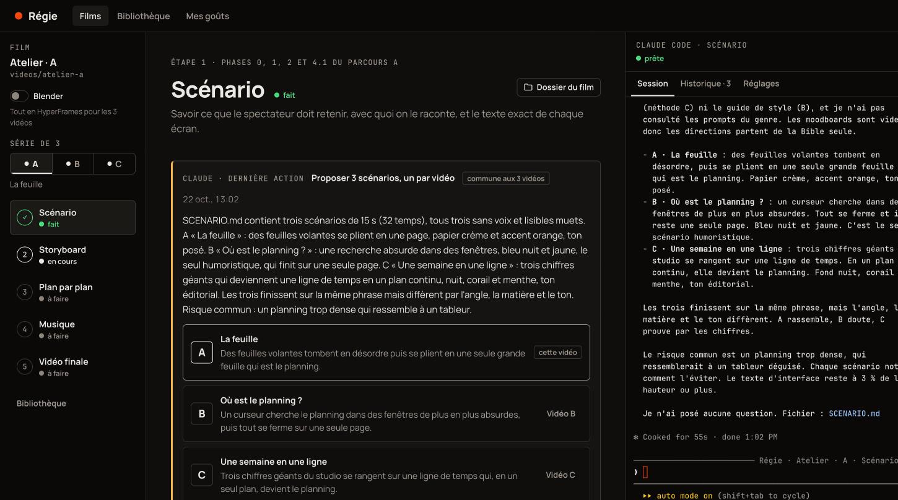
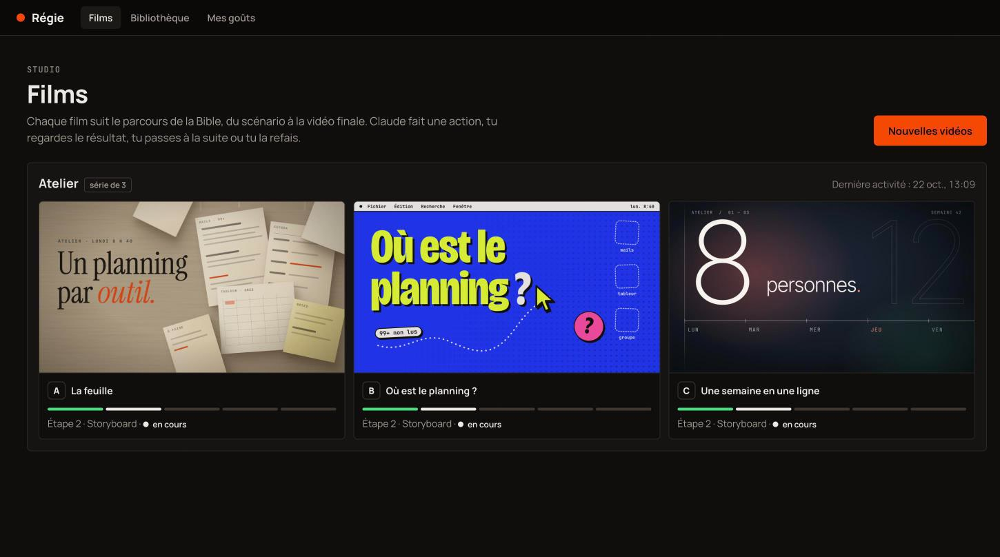

<div align="center">

<a name="readme-top"></a>



<h1>Régie</h1>

<p><strong>A motion design studio on your Mac, where Claude Code makes the films and you direct.</strong><br>
Brief, scenario, storyboard, shot by shot, music, final cut. Claude does one step, you look at the result, you decide what comes next.</p>

<p>
  <a href="https://github.com/Shyhnz/regie/releases/latest"></a>
  
  <a href="LICENSE"></a>
  
</p>

<p>
  <a href="https://github.com/Shyhnz/regie/releases/latest"><strong>Download</strong></a> ·
  <a href="#the-library"><strong>The library</strong></a> ·
  <a href="#how-a-film-is-made"><strong>How a film is made</strong></a> ·
  <a href="#getting-started"><strong>Getting started</strong></a> ·
  <a href="bible/README.md"><strong>The Bible</strong></a>
</p>

</div>

<p align="center">
  
</p>

## Why Régie

Ask Claude for "a 15-second launch video" and you get something that moves, and looks like every other AI video: small text on a flat background, a camera that drifts for no reason, music laid on top at the end.

Good motion design is a method. A senior motion designer decides what the viewer must remember, chooses the look on real frames before building anything, cuts on the music, builds each shot against its storyboard, then gets a fresh pair of eyes to critique it. Régie gives Claude that method, and a library of what works, so you can direct instead of prompting.

> The interface, the method and the library are written in French.

## The library

Régie ships with **the Bible**: everything we learned about making motion videos with Claude, filed so that Claude can find the right technique at the right moment, and you can browse it in the app.

| | |
| --- | --- |
| **233 videos analysed frame by frame** | Every video made with Claude on [prompt-motion.com](https://prompt-motion.com), watched frame by frame around its key moments: what it does well, what to steal, its flaws, its palette, whether the animation really follows the music. They play in the app from their source, at the exact passage each technique comes from. |
| **14 chapters, 175 entries** | Styles, composition, typography, transitions, camera and 3D, shapes and materials, data and interfaces, characters, timing and sound, structure, consistency and clichés, production method, prompting, 60 fps studies. Each technique has a name in French and English, a "when to use it", a HyperFrames (GSAP) recipe and an After Effects recipe. |
| **A production method** | A 10-phase route, 6 style guides, 14 shot recipes (hook, product reveal, cursor demo, number proof, signature…) and 10 tools: render contract, timeline tokens, critique grid, contact sheets, measured sound, and a Blender recipe for heavy 3D. |
| **7,159 rules from 198 open-source skills** | The video skills listed by [awesome-claude-video-skills](https://github.com/zhuyansen/awesome-claude-video-skills) were read one by one (198 repositories, plus an article on Claude motion workflows). What the Bible did not already know was rephrased, filed by chapter and linked to its source file. |
| **2,118 prompts and templates** | Indexed by genre (product promo, explainer, kinetic type, data viz, UI demo, music clip, style presets…), each with a summary and a link to read it at its source. |

More than 300,000 words in all. See [bible/README.md](bible/README.md) for how it was made.

<p align="center">
  
</p>

<table>
  <tr>
    <td width="50%"></td>
    <td width="50%"></td>
  </tr>
</table>

Each fiche, rule or prompt can be **added to a film** with a note. It lands in the film's `MOODBOARD.md`, and Claude starts from there.

<div align="right"><a href="#readme-top">Back to top ↑</a></div>

## How a film is made

<p align="center">
  
</p>

Every film follows five steps. Each step has its actions; each action is one turn of Claude, with its proof (files, images, sounds) shown in the app.

1. **Scenario.** Claude fills the brief from your answers and asks instead of inventing, proposes three really different scenarios, then writes the chosen one with the exact text of every screen and its timing in beats.
2. **Storyboard.** Three art directions in real frames, one picked on the image, turned into tokens (`STYLE.md`, `motion.js`), cut into shots on the musical grid (`SHOTLIST.md`, `timeline.js`), and one storyboard frame per shot.
3. **Shot by shot.** Each shot is built against its storyboard frame and checked on its key frames. Then the first cut, a contact sheet, a phone-size sheet, and a critique by a fresh session that never saw the code.
4. **Music.** A soundtrack composed in code from `timeline.js`, every hit measured to the sample, −14 LUFS.
5. **Final video.** 60 fps master, recomposed 9:16 and 1:1 versions, web encodes, posters, ffprobe checks.

There are no gates: moving on means you are happy with it, going back means redo.

### Three videos at a time

By default Régie makes a **series of three videos** from one brief. Each gets its own scenario and its own art direction, decided together so they never look alike. Shared steps run once; the rest can run on the three in parallel.

<p align="center">
  
</p>

The film in these screenshots, "Atelier", is a fictional product: three Claude actions (brief, three scenarios, three art directions) and about ten minutes.

### A real Claude Code session

The panel on the right is Claude Code itself, the one from your terminal, running in the film's folder on your own Claude account. Action buttons type their instruction into it. You can write to Claude at any time, interrupt it, answer its questions. Each step keeps its conversation, so you can come back to a film days later.

### Blender when it matters

A switch under the film's title tells Claude whether it may use Blender. On, Claude follows the Blender recipe for the shots the browser renders badly (glass, reflections, real volumes, physics) and renders them from the command line; the rest stays in [HyperFrames](https://www.npmjs.com/package/hyperframes). Off, everything is HTML.

### Your taste wins

"Mes goûts" keeps the effects you love and the ones you reject. Claude reads it before every action, and it overrides the Bible's defaults.

<div align="right"><a href="#readme-top">Back to top ↑</a></div>

## Getting started

<p>
  <a href="https://github.com/Shyhnz/regie/releases/latest"></a>
</p>

1. **Install the tools Régie drives.** [Claude Code](https://docs.claude.com/en/docs/claude-code/overview), logged in to your Claude account; [Node.js](https://nodejs.org) 20 or later; [ffmpeg](https://ffmpeg.org) (`brew install ffmpeg`). Optional: [Blender](https://www.blender.org) 4.2 or later for 3D shots.
2. **Install Régie.** Open `Regie_<version>_universal.dmg` and drag Régie to Applications. It runs on Apple silicon and Intel Macs, macOS 13 or later.
3. **Create your first videos.** Click "Nouvelles vidéos", give them a name, answer the brief. Your films live in `~/Documents/Régie`.

<details>
<summary><strong>First launch on macOS</strong> (the app is not notarized yet)</summary>
<br>

1. Open Régie from Applications. macOS says it cannot verify the app. Click **Done**.
2. Open **System Settings > Privacy & Security**, scroll down and click **Open Anyway** next to Régie.
3. Confirm with your password. The app opens, and it will not ask again.

The first time Claude works in a film, Claude Code asks in the panel whether you trust the folder: answer yes.

</details>

Régie uses your Claude subscription through Claude Code. A film is many turns of Claude: watch your usage, and run heavy actions (three art directions, a full assembly) when you have room.

## Build from source

```sh
npm install
npm run dev               # the app in your browser, http://localhost:4317
npm test                  # server tests
mac/build-release.sh      # Régie.app and its .dmg, in release/
```

<details>
<summary><strong>How it works</strong></summary>
<br>

Régie is a small Node server (Express) and a React interface, wrapped in a native macOS window (Swift, WKWebView). It only listens on `127.0.0.1`.

Each film is a folder copied from the studio template (`studio/`): brief, scenario, style tokens, shot list, a `timeline.js` that is the only source of time for image and sound, a render contract, a log. Claude Code runs in that folder in a pseudo-terminal, with the Bible and the studio added as readable folders and a system prompt for the current step. It reports back through Claude Code hooks (session start, prompt sent, turn finished, waiting for you) on a token-protected local endpoint, and leaves a `handoff.json` with its summary, questions, options, images and files, which the app turns into the step's page.

Nothing leaves your Mac except what Claude Code sends to Claude, and the reference videos the library streams from prompt-motion.com.

</details>

## Credits

The reference videos and their prompts belong to their authors on [prompt-motion.com](https://prompt-motion.com); the open-source skills belong to their authors on GitHub. Régie links to them and does not copy them. See [NOTICE.md](NOTICE.md).

## Contributing

Issues and pull requests are welcome, corrections to the Bible too. Read [CONTRIBUTING.md](CONTRIBUTING.md) first.

## License

[MIT](LICENSE). Copyright 2026 NUOPS.

<div align="center">
<br>
<sub>Made by Shyhn. If Régie helps you make a film you're proud of, a ⭐ helps others find it.</sub>
</div>
